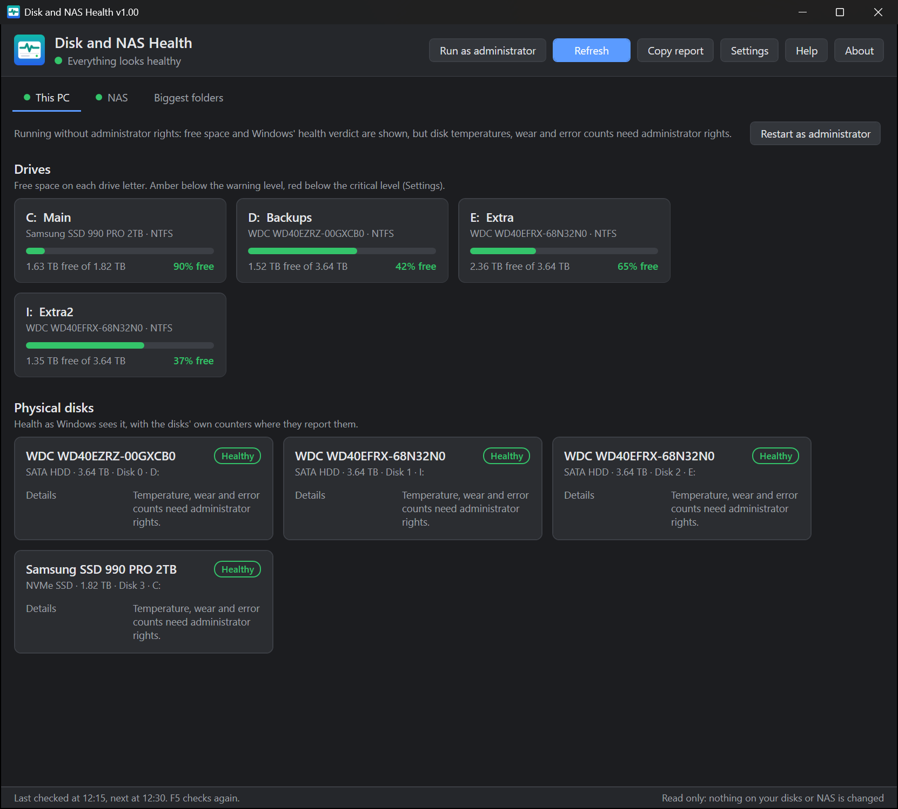

<p align="center">
  
</p>

# Disk and NAS Health

Free space, drive health and the biggest folders, for this PC and your NAS, in one window.

    

## ✨ Features

Disk and NAS Health is a PowerShell/WPF tool that checks every drive on your PC and your Synology NAS in one window, and tells you in one line whether anything needs a look. It only reads: nothing is ever written to, tested on or changed on any disk.

- **One-line verdict**: under the title, green for *Everything looks healthy*, amber for warnings, red for problems (hover for the full list). Every tab has a coloured dot and its own list at the top.
- **This PC, drives**: free space on every fixed and removable drive letter, with a bar that turns amber below 15% free and red below 5% (both set in Settings).
- **This PC, physical disks**: model, NVMe, SATA or USB, SSD or HDD, size, which drive letters live on it, and Windows' own health verdict. **Run as administrator** (one click) to add each disk's temperature, wear, power-on hours and uncorrected read and write errors.
- **A tab for each NAS**, read over SSH with your key:
  - system: host name, DSM version, uptime, load, memory and temperature,
  - free space on each volume,
  - RAID state of every array: healthy, degraded, rebuilding (with progress and time left) or data scrubbing,
  - every disk's SMART health from `smartctl`: overall result, temperature, power-on hours, reallocated, pending and uncorrectable sectors and cable (CRC) errors, or wear and media errors for NVMe.
- **Biggest folders**: pick This PC or a NAS and a folder, press **Scan**, and see its folders biggest first with their share of the total, plus the largest files underneath (this PC). Double-click to go in, **Up** or Backspace to come back, **Stop** to end early, right-click for **Open in Explorer** and **Copy path**.
  - This PC: a fast scanner reads folder listings only (never the files), keeps five levels so going in and out is instant, skips junctions so nothing is counted twice, and counts OneDrive online-only files as 0 because they use no space.
  - NAS: measured with `du` over SSH, one level at a time, with a note of any folders the SSH user can't read.
- **Copy report**: everything as plain text on the clipboard, ready to paste into a note.
- **Checks again by itself** every 15 minutes (or whenever you like, or never), and **F5** checks now. The disks and the NAS are read in the background, so the window never freezes.
- **Settings**: your NAS machines (name, SSH login, port) with **Test connection**, the free-space and temperature levels, the re-check time and the theme (Auto follows Windows, or Light or Dark). The first time, the NAS list is copied from Homelab or Docker Container Manager if you use them.
- **Help** (F1) explains every part, including how to let the NAS share SMART over SSH.

## 🖼️ Screenshots



## 📋 Requirements

- Windows 10 or 11.
- Windows PowerShell 5.1 (built into Windows) with .NET Framework 4.7.2 or later.
- For a NAS: Windows' **OpenSSH Client** (Settings > System > Optional features), SSH turned on on the NAS (DSM: Control Panel > Terminal and SNMP), and key login for your SSH user. Disk and NAS Health never asks for or stores a password.
- For NAS disk SMART (optional): a sudo rule that lets your SSH user run `smartctl` without a password. See [NAS SMART](#nas-smart).
- For disk temperatures, wear and error counts on this PC (optional): administrator rights.

## 📦 Installation

1. Download `Disk-and-NAS-Health-v1.01.zip` from the [latest release](../../releases/latest).
2. Right-click the zip, choose **Properties**, tick **Unblock** and click OK, *before* extracting it. (Or, after extracting, run `Get-ChildItem -Recurse 'Disk and NAS Health v1.01' | Unblock-File` in PowerShell.) Files from the internet carry Windows' Mark of the Web, which makes Windows warn about or block scripts.
3. Extract it anywhere. You get a `Disk and NAS Health v1.01` folder.
4. Double-click **Disk and NAS Health.cmd** in that folder. It makes a **Disk and NAS Health** shortcut in the folder and in the Start menu, then starts it.

From then on, start it from the shortcut or the Start menu, and pin it to the taskbar if you like: it starts without a console window and shows its own icon. For a new version, extract it and run its .cmd once; the Start menu shortcut then points at the new folder. Settings are kept in `%APPDATA%\Disk and NAS Health`, so they carry over.

Nothing is installed and no Windows settings are changed. The shortcut runs the script with PowerShell's execution policy bypassed for that run only.

**From the repo:** clone it and double-click **Start Disk and NAS Health.cmd**.

### Why no exe

Home tools used to ship as PS2EXE exes, and antivirus programs (ESET among them) kept flagging those exes as generic trojans by mistake. A plain script and a shortcut give the same one-click start without the false alarms, and you can read exactly what runs.

### Build a release

Double-click **Build.cmd** in the repo folder. It reads `build.json`, checks every script for syntax errors and that `$script:AppVersion` matches the newest `CHANGELOG.md` entry, runs PSScriptAnalyzer if it's installed, copies the release files into `..\Builds\Disk and NAS Health v<version>\`, zips that folder for the GitHub release, refreshes `..\Builds\Disk and NAS Health.lnk` (what the Home Launcher starts) and scans the result with ESET's command-line scanner if it's installed.

## 🚀 Usage

1. Start Disk and NAS Health. It reads this PC and every NAS straight away.
2. Read the line under the title. Green means nothing needs a look. Otherwise it says how many problems and warnings there are and shows the worst one; hover over it, or open the tab with the amber or red dot, for the rest.
3. **This PC**: the drives and the physical disks. Press **Run as administrator** for temperatures, wear and error counts.
4. **Your NAS tab**: system, volumes, RAID and disks. If it can't connect, the tab says why (NAS off, SSH off, key not accepted).
5. **Biggest folders**: choose **This PC** or a NAS, type or browse to a folder (for example `D:\` or `/volume1`) and press **Scan** or Enter. Double-click folders to go in.
6. **Copy report** puts a summary on the clipboard.

### What counts as a problem

| Problem (red) | Warning (amber) |
| --- | --- |
| Drive or volume below the problem level of free space (5%) | Below the warning level (15%) |
| Windows says a disk is Unhealthy | Windows says Warning, or the disk isn't OK |
| SMART failing, or an attribute that has failed | Reallocated sectors, media errors |
| Pending or uncorrectable sectors | Uncorrected read or write errors (this PC) |
| A degraded RAID array | An array rebuilding or resyncing |
| An SSD worn out (100% used) | 90% used, or a disk hotter than its level (50 °C HDD, 70 °C SSD) |
| The NAS can't be reached | |

### NAS SMART

`smartctl` has to run as root, and over SSH your user isn't root, so SMART only shows if sudo lets your user run `smartctl` without a password. Everything else works without it. To allow it, sign in to the NAS over SSH yourself and run (sudo -i asks for your DSM password; put your SSH user name in place of `YOURUSER`, and use the path that `command -v smartctl` prints if it isn't `/usr/bin/smartctl`):

```sh
sudo -i
command -v smartctl
echo 'YOURUSER ALL=(root) NOPASSWD: /usr/bin/smartctl' > /etc/sudoers.d/disk-nas-health
chmod 440 /etc/sudoers.d/disk-nas-health
exit
```

**Settings > Test connection** then says *SMART can be read*. A big DSM update can remove the file; just add it again.

## ⚙️ Configuration

**Where settings live:** everything Disk and NAS Health stores is in `%APPDATA%\Disk and NAS Health\` (`settings.json` and a log). It stays on your PC and is never inside the repo or the `Builds\` folder, so rebuilding or updating can't touch it.

Change everything in **Settings**:

| Setting | Default | What it does |
| --- | --- | --- |
| Machines | copied from Homelab or Docker Container Manager | Each NAS: a name (its tab), the SSH login `user@address` and the SSH port (blank for 22). |
| Warning level | 15% | A drive or volume with less free space than this is a warning. |
| Problem level | 5% | Less free space than this is a problem. |
| Hard disk temperature | 50 °C | Above this, a hard disk gets a warning. |
| SSD temperature | 70 °C | Above this, an SSD or NVMe drive gets a warning. |
| Check again every | 15 minutes | 0 checks only when you press Refresh or F5. |
| Theme | Auto | Auto follows Windows' app mode; or Light or Dark. |

Disk and NAS Health connects with `ssh -o BatchMode=yes` (key login only, never a password prompt) and sends one read-only script to `sh` on the NAS. You can read exactly what it runs in `Disk-and-NAS-Health.ps1` (`$script:NasReportScript`).

## 📝 Changelog

See [CHANGELOG.md](CHANGELOG.md).

## 📄 Licence

[MIT](LICENSE). Copyright (c) 2026 Jason Rhodes.

Created by Jason Rhodes, built with Claude (Anthropic).
